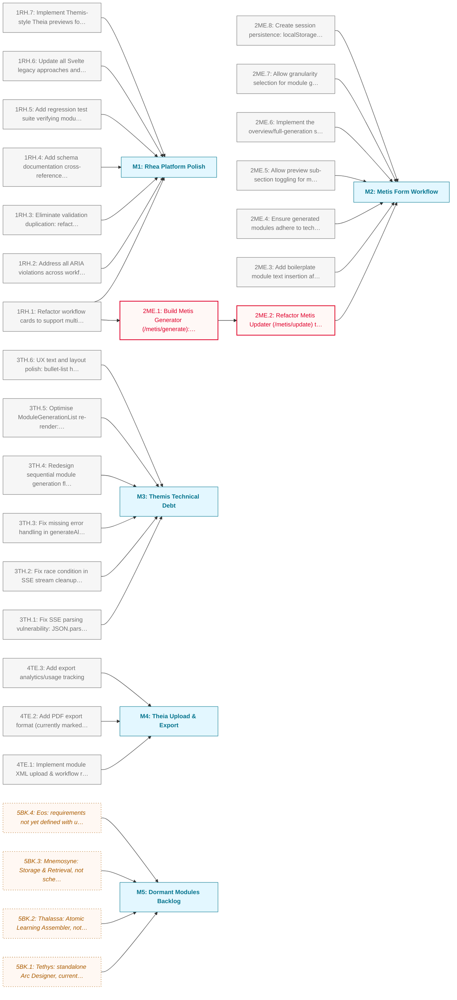

# Rhea Post-MVP Hardening Roadmap

Rhea's core Metis and Themis workflows reached MVP in October 2025, followed by a system-wide consistency audit in December 2025. This phase works through what the audit and ongoing use surfaced: platform polish, the Metis form-based workflow redesign, Themis technical debt, and Theia's remaining upload/export gaps. Four dormant submodules (Tethys, Thalassa, Mnemosyne, Eos) are tracked as backlog rather than active work.

**Critical path:** `1RH.1 → 2ME.1 → 2ME.2`; the workflow card refactor unblocks the Metis Generator, which in turn unblocks the Updater modernisation.

---

## Milestone 1: Rhea Platform Polish

**Goal:** Clean up cross-cutting platform debt identified by the December 2025 consistency audit and prepare the homepage for multi-subflow workflows.

- [ ] **1RH.1**: Refactor workflow cards to support multiple subflows: expandable card state, dynamic subflow detection from route structure, subflow metadata, responsive layout
  - Note: Blocks Metis Generator work (2ME.1). High priority.
- [ ] **1RH.2**: Address all ARIA violations across workflow components
- [ ] **1RH.3**: Eliminate validation duplication: refactor courseValidator.ts to wrap and call validateModuleXML() instead of reimplementing ~85 lines of module validation logic
  - Note: Effort: 2-3 hours. From consistency audit remediation.
- [ ] **1RH.4**: Add schema documentation cross-references between metis/outputSchema.xml and courseSchema.xml explaining the embedding relationship
  - Note: Effort: 15 minutes. Low priority.
- [ ] **1RH.5**: Add regression test suite verifying module generation consistency across Metis/Themis workflows (identical validation, schema structural equality, CI integration)
  - Note: Effort: 4-6 hours.
- [ ] **1RH.6**: Update all Svelte legacy approaches and implementations to use Svelte 5 idioms throughout
- [ ] **1RH.7**: Implement Themis-style Theia previews for Metis (and Metis-in-Themis)

---

## Milestone 2: Metis Form Workflow

**Goal:** Replace the XML-upload requirement with a Themis-style guided form workflow, splitting Metis into a form-based Generator and a modernised XML Updater.

- [ ] **2ME.1**: Build Metis Generator (/metis/generate): six-step form workflow (planning, objectives, project briefs, research topics, skills, review & generate), new form components, wired to the existing generation pipeline _(blocked: depends on 1RH.1)_
  - Note: Architecture split: Generator (form-based, new) vs Updater (XML upload, existing).
- [ ] **2ME.2**: Refactor Metis Updater (/metis/update) to accept single generated-module XML as primary input, with legacy 3-file upload as a fallback toggle; add module comparison/diff view _(blocked: depends on 2ME.1)_
  - Note: Priority: medium, after 2ME.1 complete.
- [ ] **2ME.3**: Add boilerplate module text insertion after generation
- [ ] **2ME.4**: Ensure generated modules adhere to tech stack requirements
- [ ] **2ME.5**: Allow preview sub-section toggling for module spec subsections (objectives, research topics/subtopics, project briefs/skills/examples), applied in both Metis and Metis-in-Themis
- [ ] **2ME.6**: Implement the overview/full-generation split pattern (from Themis) in Metis
- [ ] **2ME.7**: Allow granularity selection for module generation (separate booleans per section: project briefs, twists, research topics), with fill-in-missing-detail follow-up pass
- [ ] **2ME.8**: Create session persistence: localStorage progress backup, restore-on-load confirmation, clear-session button

---

## Milestone 3: Themis Technical Debt

**Goal:** Resolve known correctness and performance issues in the Themis module generation flow flagged during the October 2025 component refactor.

- [ ] **3TH.1**: Fix SSE parsing vulnerability: JSON.parse(line.slice(6)) in ModuleGenerationList.svelte throws on malformed server JSON and can crash the generation flow
- [ ] **3TH.2**: Fix race condition in SSE stream cleanup: reader removal from activeReaders in a finally block can conflict with onDestroy running concurrently
- [ ] **3TH.3**: Fix missing error handling in generateAll: currently continues generating remaining modules after a critical failure instead of stopping
- [ ] **3TH.4**: Redesign sequential module generation flow to reduce total wait time on large courses while preserving cross-module coherence (e.g. start module[x] once module[x-1]'s overview is ready, before its full detail completes)
- [ ] **3TH.5**: Optimise ModuleGenerationList re-render: extract ModuleCard to a separate component or use keyed blocks so store updates don't re-render the full list on 20+ module courses
- [ ] **3TH.6**: UX text and layout polish: bullet-list handling in CourseOverview, Phase 3 (Module Planning) and Phase 4 (Structure Review) text/layout, toggleable module previews, independent toggle state for siblings

---

## Milestone 4: Theia Upload & Export

**Goal:** Complete the upload/resume round-trip for module XML and round out export format coverage.

- [ ] **4TE.1**: Implement module XML upload & workflow resume: /theia upload interface, XML-to-store transformer, continue-in-Metis or preview/export actions, validation error handling
- [ ] **4TE.2**: Add PDF export format (currently marked "coming soon" in UI)
- [ ] **4TE.3**: Add export analytics/usage tracking

---

## Milestone 5: Dormant Modules Backlog

**Goal:** Track not-yet-started submodules so they stay visible without competing with active work.

- [ ] **5BK.1**: Tethys: standalone Arc Designer, currently embedded within Themis; on hold until Themis & Metis MVP fully implemented _(deferred: parked for a later phase)_
- [ ] **5BK.2**: Thalassa: Atomic Learning Assembler, not yet started, requirements not yet defined with user _(deferred: parked for a later phase)_
- [ ] **5BK.3**: Mnemosyne: Storage & Retrieval, not scheduled until after MVP _(deferred: parked for a later phase)_
- [ ] **5BK.4**: Eos: requirements not yet defined with user _(deferred: parked for a later phase)_

---

## Dependency Diagram

